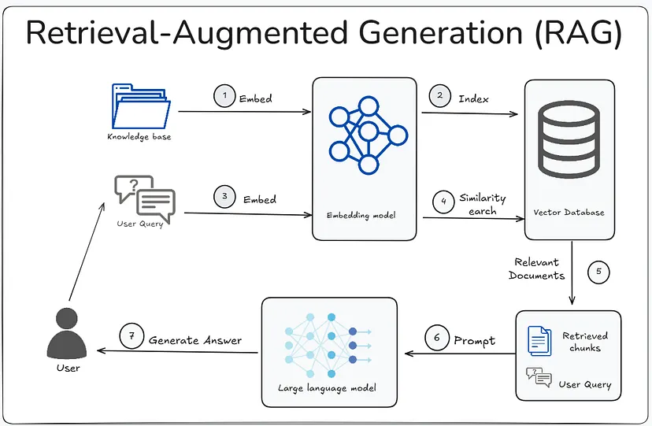

# Physics Chatbot (RAG-based)

An AI-powered educational chatbot designed to help **Class 9–10 students** understand physics concepts, solve numerical problems, and explore textbook topics interactively.  
The system uses a **Retrieval-Augmented Generation (RAG)** pipeline with open-source language models and operates **fully offline**.

---

## 🚀 Key Features

- Physics question answering aligned with the Class 9–10 curriculum
- Step-by-step explanations for both conceptual and numerical problems
- Retrieval-Augmented Generation (RAG) for context-aware responses
- Offline execution using locally hosted open-source LLMs
- Textbook-aware responses using embedded chapter-wise content
- Multi-model support (Llama, Mistral, Gemma family)
- Chat history–aware query reformulation
- Interactive web interface built with Streamlit

---

## 🧠 How It Works (High Level)

1. **Textbook Processing**
   - Physics textbook converted to Markdown
   - Chunked by chapters, headers, and subheaders
   - Embedded and stored in a vector database

2. **Query Handling**
   - User query is reformulated using chat context
   - Relevant chunks are retrieved via semantic search

3. **Answer Generation**
   - Retrieved context is passed to a local LLM
   - Model generates a grounded, context-aware response

---

## 🛠 Tech Stack

### Core
- **Python**
- **Retrieval-Augmented Generation (RAG)**

### AI / NLP
- Ollama (local LLM runtime)
- Llama 3.1 / 3.2
- Mistral
- Gemma 2
- LangChain
- Sentence Transformers

### Data & Storage
- ChromaDB (Vector Database)
- Pandas, NumPy

### Interface
- Streamlit

---

## 🏗 Architecture

The system follows a modular RAG architecture:

- **Embedding Layer** – Converts textbook chunks into vectors
- **Vector Store** – Stores and retrieves relevant context
- **Retriever** – Finds top-K relevant chunks per query
- **Generator (LLM)** – Produces answers using retrieved context
- **UI Layer** – Interactive chat interface

This design ensures **low hallucination**, **high relevance**, and **offline usability**.

---

## 🧪 Evaluation Summary

- **4,000 test cases** derived from textbook + synthetic queries
- Evaluated using:
  - Cosine Similarity
  - BERTScore
  - LLM-based semantic validation
- Best overall performance achieved using **LLM-based validation**
- Strong performance on:
  - Short factual queries
  - Conceptual explanations
- Known weakness:
  - Complex numerical precision (planned improvement)

---

## 🔐 Key Design Decisions

- Fully **offline-first** (no cloud APIs)
- Open-source models only
- Curriculum-constrained knowledge base
- Emphasis on **faithfulness over fluency**

---

## 📖 Technical Documentation

Detailed design decisions, including chunking, embeddings, and the RAG pipeline,
are documented in the project Wiki:
➡️ https://github.com/almahfuz777/Ollama_RAG/wiki
